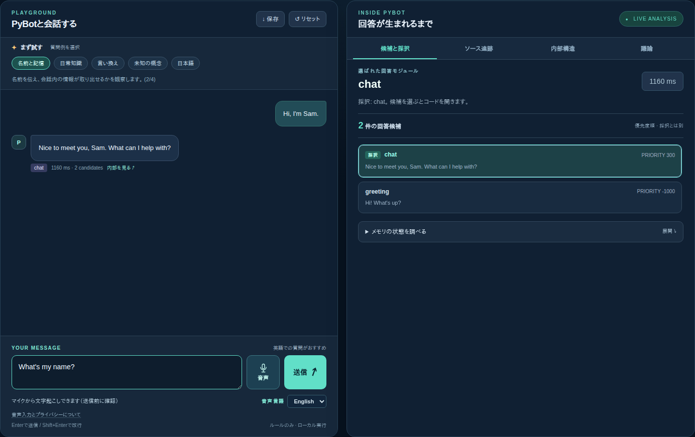
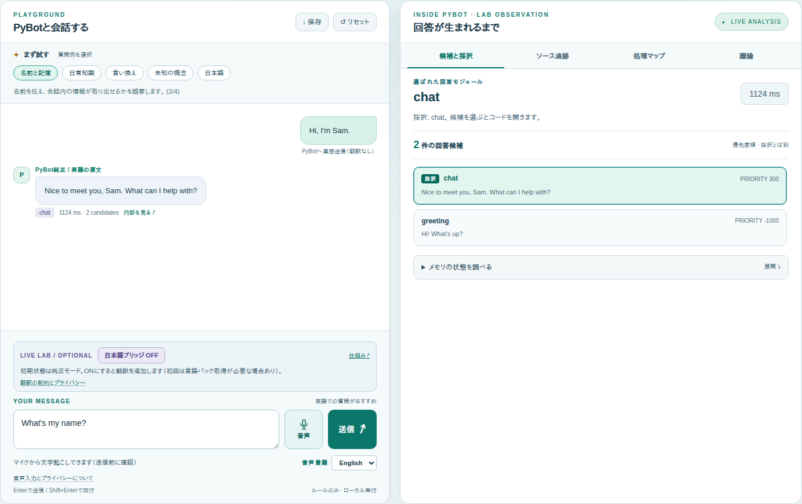
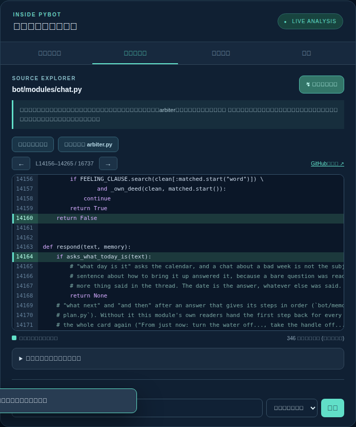
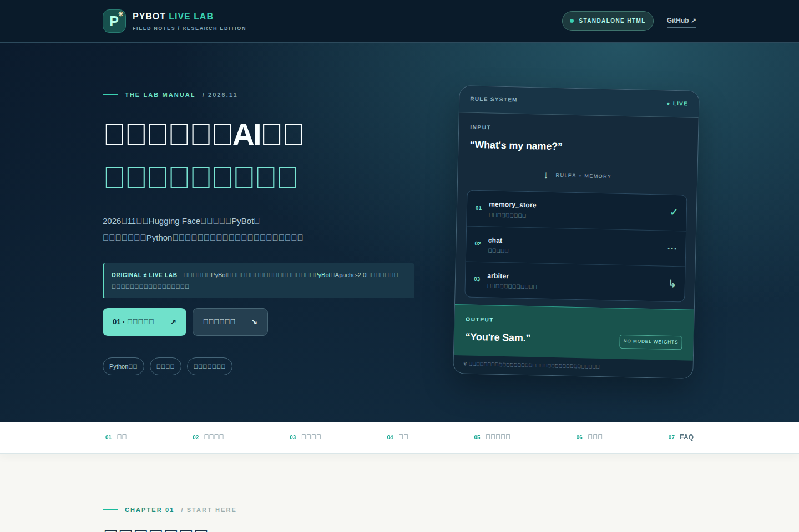
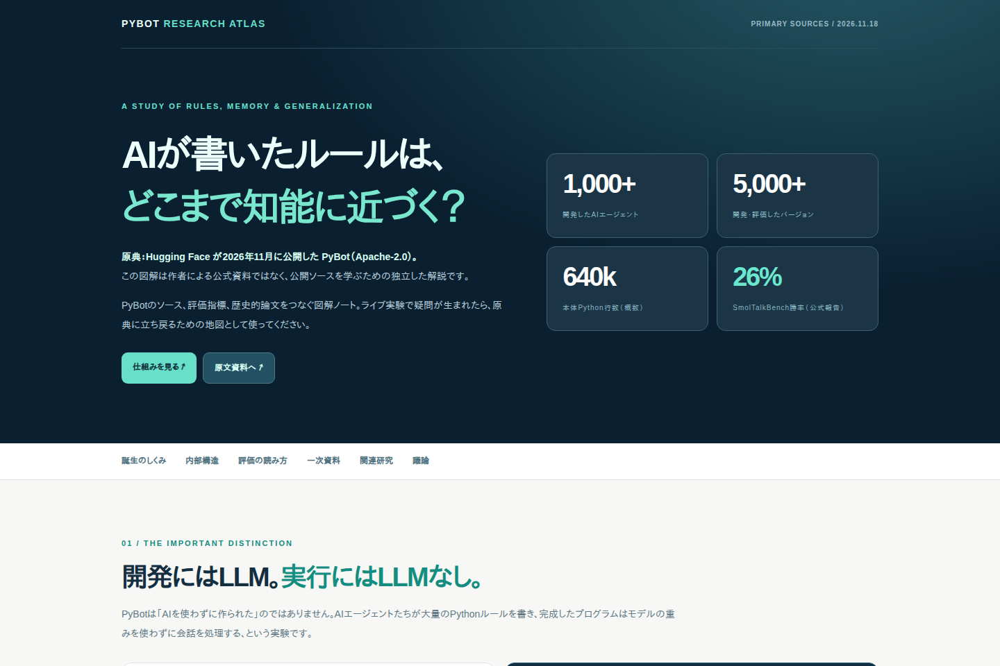

# PyBot Live Lab

<strong>64万行のルールは、「理解」にどこまで近づける？</strong>

<strong>元のPyBotとは？</strong> 2026年11月、Hugging Faceが公開した、AIエージェント群が大量のPythonルールを書いて作ったチャットボットです。推論時にはLLMの重みを使わず、元のコードは <a href="https://github.com/huggingface/pybot/blob/main/LICENSE">Apache License 2.0</a> で公開されています。

<strong>このLive LabはPyBotの作者・公式アプリではありません。</strong> 公開済みのPyBotを<strong>「知る・試す・読み解く」</strong>ための独立した勉強会用ツールです。<a href="docs/RESEARCH.html">背景と原典 ↗</a>

 

▲ 実際のPyBotを動かして撮影したダーク画面です。左で質問し、右で「なぜこの回答になった？」を調べます。画像をクリックすると拡大できます。

<strong>☀️ ライトモードの実画面も見る</strong>

右上のテーマ切り替えボタンから、ライトとダークを選べます。初回はOSの設定に合わせます。

  

<a href="#-3ステップで起動"><strong>🚀 すぐに動かす</strong></a>　·　<a href="docs/MANUAL.html"><strong>📖 図解マニュアル</strong></a>　·　<a href="docs/RESEARCH.html"><strong>📚 原典・論文の図解</strong></a>　·　<a href="#-ライブでできること"><strong>🔬 できること</strong></a>

---

## 🔬 ライブでできること

| 体験 | 勉強会で何がわかる？ |
| --- | --- |
| 🎙️ **話しかける** | マイクで質問を文字起こし、編集・確認してからPyBotへ送信。もちろんキーボードも使えます。 |
| 🌓 **表示を切り替える** | OS設定に合わせてライト／ダークを初期選択。アプリ右上のボタンでいつでも変更できます。 |
| 🔠 **文字を拡大する** | A− / A＋で100〜175%まで拡大し、「発表」で会話・解析を大きく投影。 |
| 🇯🇵 **日本語で試す（オプション）** | 対応Chrome/Edgeのブラウザ内蔵翻訳を利用。入力した日本語・PyBotに渡した英語・純正の英語回答・和訳を区別。 |
| 🧭 **処理マップを見る** | 再実行したPyBotの観察→候補→選択→後処理と、関数の実際の呼び出し順を俯瞰。コードにジャンプ。 |
| 💬 **回答候補を見比べる** | 実際に提案された複数の回答、採択されたモジュール、優先度、応答時間を確認。 |
| 🔍 **Pythonコードを追う** | 回答候補から元のファイルを開き、実行行・補助関数・回答選択器 `arbiter.py` を調べる。 |
| 🧪 **弱点を実験する** | 名前の記憶、言い換え、未知の概念、日本語への反応を比較して、LLMとの違いを議論。 |
| 📚 **原典に立ち戻る** | PyBot公式ソース・ベンチマーク・ELIZAなどの一次資料へ、アプリからすぐアクセス。 |

### コードがどこを通ったのか、その場で見る

▲ ルールを選ぶと実コードへ移動。色付きの行は会話を再実行して計測した実行行です。元のターンとの一致・不一致も表示します。

## 🖼️ 図解で学べるマニュアルと研究資料

難しい専門用語を覚える前に、まず図やスクリーンショットを眺めて、全体像をつかめます。

<table>
  <tr>
    <td width="50%" valign="top" align="center">
       
      <strong>📖 図解操作ガイド</strong> 
      Mac/Windowsの起動、音声入力、実験、コード追跡、45分の勉強会進行案 
      <a href="docs/MANUAL.html"><strong>マニュアルを見る ↗</strong></a>
    </td>
    <td width="50%" valign="top" align="center">
       
      <strong>📚 PyBot Research Atlas</strong> 
      内部構造、評価指標の読み方、公式ソース、ELIZA原著論文、The Bitter Lesson 
      <a href="docs/RESEARCH.html"><strong>研究資料を見る ↗</strong></a>
    </td>
  </tr>
</table>

> **HTMLは単体でも読めます。** `docs/MANUAL.html` はCSSと実画面画像を埋め込んだ自己完結ファイル、`docs/RESEARCH.html` も単体で表示できる図解ページです。GitHub上のプレビューではなく、必要に応じてファイルを保存してブラウザで開いてください（外部の原典リンクはオンライン接続が必要です）。

## 🚀 3ステップで起動

**必要なもの：Python 3.8以上。** GPU・LLMのAPIキー・追加pipパッケージは不要です。

1. このページの緑色の **Code → Download ZIP** から一式をダウンロードし、ZIPを展開する（`git clone` でも可）。
2. お使いのOSのファイルを**ダブルクリック**する。
3. 自動的に開くブラウザで「名前と記憶」などの実験シナリオを選び、質問を送る。

| macOS | Windows |
| --- | --- |
| **`start_mac.command`** をダブルクリック | **`start_windows.bat`** をダブルクリック |
| ターミナルなら `python3 launch.py` | ターミナルなら `py -3 launch.py` |

初回のみインターネット接続を使い、公開されているPyBotの**固定コミット**を `.runtime/pybot` に取得します。以降は保存したコードをローカルで使います。起動スクリプトのウィンドウを閉じるかCtrl+Cで終了できます。

<strong>Macで初回ダウンロードがSSL証明書エラーになる場合</strong>

Python.orgからインストールしたPythonで `CERTIFICATE_VERIFY_FAILED` が出る場合があります。最新版のLive LabではPythonのHTTPS検証が失敗したときに、macOSのシステム証明書を使う `/usr/bin/curl` で安全に再試行します（TLS検証は無効化しません）。

それでも失敗した場合はFinder → アプリケーション → `Python 3.13` → `Install Certificates.command` を開き、再度 `start_mac.command` を実行してください。Pythonのバージョンが異なる場合は、そのバージョンのフォルダにある証明書スクリプトを使用してください。

<strong>Macでファイルが開かない／既存のPyBotを使いたい場合</strong>

macOSの保護機能によりブロックされた場合は、ファイルを右クリックして「開く」で内容を確認してください。既にPyBotを取得済みの場合は、環境変数 `PYBOT_DEMO_SOURCE` でそのソースの親フォルダを指定できます。詳しくは[操作マニュアル](docs/MANUAL.html)を参照してください。

## 💡 勉強会でまず試したい質問

| テーマ | 質問例 | 見るポイント |
| --- | --- | --- |
| 名前と記憶 | `Hi, I'm Sam.` → `What's my name?` | 記憶の保存と呼び出し |
| 言い換え | `How long should I boil an egg?` | 言い回しを変えると候補は変わる？ |
| 未知の概念 | `Explain Quantum Banana Regression.` | 未知入力をどう処理する？ |
| 言語 | `こんにちは。私の名前は太郎です。` | 英語以外でも通用する？ |

**おすすめの進め方：** まず回答を予想し、質問を実際に送信。その後に**採択候補 → 非採択候補 → 実行コード**を見て、なぜそうなったかをみんなで議論します。

## 🧭 PyBot純正の挙動と Live Lab の補助機能

| 誰の処理？ | 何をしている？ |
| --- | --- |
| **PyBot純正**（Hugging Face） | 実際のPythonルール、会話メモリ、回答候補、回答選択、英語の元回答 |
| **Live Labの補助**（このリポジトリ） | ブラウザ翻訳、音声文字起こし、表示の拡大、コード呼出しの再実行観測、図解 |

日本語ブリッジは**初期OFF**です。ONにすると **日本語 → Live Lab英訳 → PyBot純正の英語回答 → Live Lab和訳** で表示します。純正の英文と採択モジュールは変更しません。ブラウザ内蔵Translator APIの対応条件に依存し、未対応ブラウザは英語の純正モードで利用できます。Chromeの[翻訳API公式資料](https://developer.chrome.com/docs/ai/translator-api)も参照してください。

**処理マップの注意**：実行行・関数の呼び出しは再実行で計測した結果です。「知識」「記憶」などの分類はファイルの位置に基づく補助的な説明であり、回答の因果理由を完全に特定したものではありません。

## 🧠 ルールベースとLLM、何が違う？

PyBotは、AIエージェントが書いた大規模なPythonのルール・辞書・会話メモリによって応答します。**開発時にはAIが関わりましたが、PyBotの会話実行時には学習済みニューラルネットワークの重みを使用しません。**

ルールの網羅性、未知の表現への汎化、記憶、説明可能性、保守性を、ソースコードを読みながら検討できます。

公式資料：[Hugging Face / PyBot](https://github.com/huggingface/pybot) · [固定版ソース](https://github.com/huggingface/pybot/tree/7d63c7fbebb44c7e466e5c8b5c1f341ab767929e) · [SmolTalkBench](https://huggingface.co/datasets/HuggingFaceSwarms/SmolTalkBench)

### 観測結果と解釈は分ける

- **元の質問の観測結果：** PyBot本体から取得した回答、候補、選択モジュール、優先度、応答時間。
- **ソースコードの実行行：** 同じ会話を再実行したときの計測結果。元の回答と一致したかも表示します。行を通ったこと自体は、その行が回答を決定した証明ではありません。

### 🎙️ 音声入力とプライバシー

マイクボタンで英語／日本語の文字起こしができます。認識結果は**送信前に確認・修正**でき、音声認識だけでは自動送信されません。

PyBotの会話処理はローカル実行ですが、**音声認識はブラウザによって外部サービスを使用する場合があります**。完全オフラインの音声認識ではない可能性があります。アプリ側に音声ファイルは保存しません。未対応のブラウザではMac標準の音声入力、またはWindowsの `Win+H` が利用できます。

## 📁 リポジトリの主なファイル

| 場所 | 内容 |
| --- | --- |
| `start_mac.command` / `start_windows.bat` | OS別のワンクリック起動 |
| `launch.py` | PyBotの準備とローカルWebサーバー起動 |
| `demo/` | 会話、候補表示、ソース追跡、音声入力、Web UI |
| `docs/MANUAL.html` | 図解・スクリーンショット入りの独立HTMLマニュアル |
| `docs/RESEARCH.html` | 原典や論文をまとめた図解HTML資料 |
| `docs/images/` | 実画面のスクリーンショットとプレビュー |
| `tests/` / `.github/workflows/` | テスト・画面キャプチャ・HTMLマニュアル更新の自動化 |
| [`docs/PLATFORM_VALIDATION.md`](docs/PLATFORM_VALIDATION.md) | Mac／Windows・ライト／ダーク・日本語表示の検証範囲と実機チェック項目 |

**出典・ライセンス：** オリジナルの [Hugging Face PyBot](https://github.com/huggingface/pybot) は Apache-2.0。PyBot本体は編集・再配布せず、初回起動時に取得する構成です。本リポジトリは独立した教育・解析用インターフェイスです。

---

<strong>実際に話しかけ、候補を比べ、コードを追ってみましょう。</strong>

<a href="#pybot-live-lab"><strong>⬆️ ページ上部のスクリーンショットに戻る</strong></a>　·　<a href="docs/MANUAL.html"><strong>📖 操作ガイド</strong></a>

